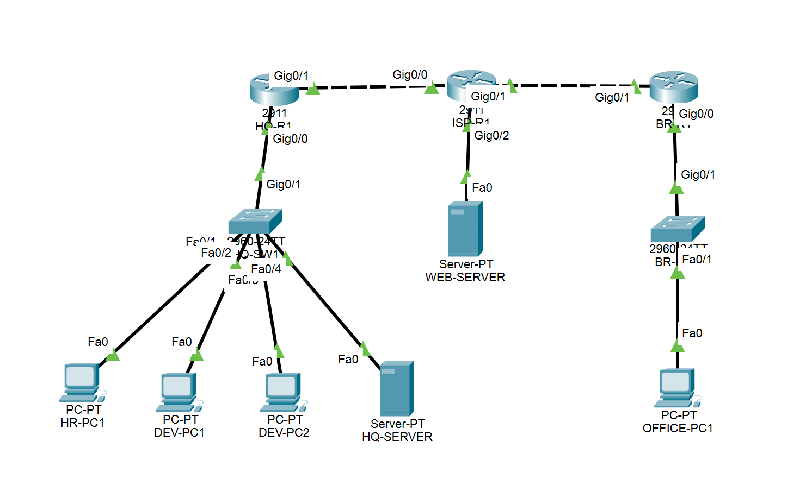
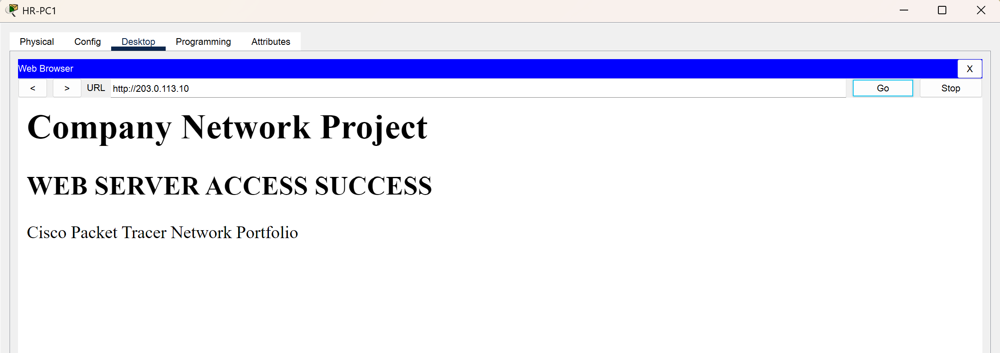
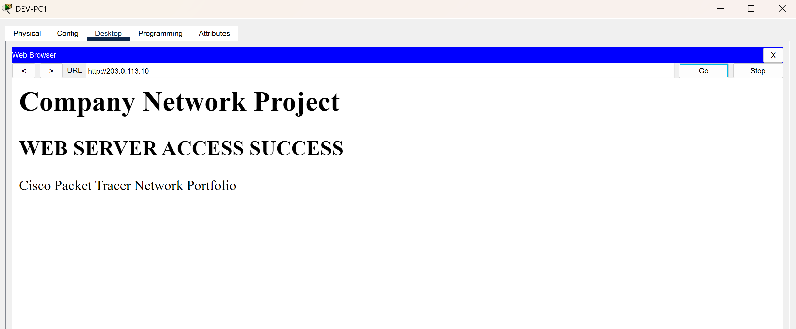
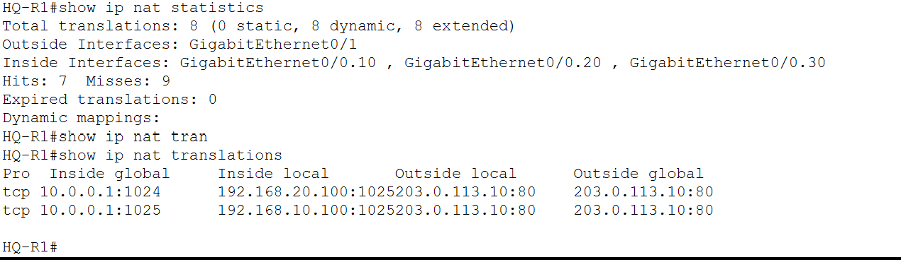

# Cisco Packet Tracer 기업 네트워크 구축 프로젝트

## 1. 프로젝트 개요

Cisco Packet Tracer를 활용하여 본사(HQ), 지사(BR), ISP로 구성된 기업 네트워크를 설계하고 구축한 프로젝트입니다.

VLAN을 통한 부서별 네트워크 분리, OSPF 동적 라우팅, DHCP 자동 IP 할당, ACL 접근 제어, NAT/PAT 주소 변환을 구현하고 통신 및 서비스 접근을 검증했습니다.

### 프로젝트 목표
- 기업 네트워크 토폴로지 설계 및 구축
- VLAN 및 Router-on-a-Stick 구성
- OSPF를 이용한 본사·지사 간 라우팅
- DHCP를 통한 클라이언트 IP 자동 할당
- ACL을 이용한 부서별 접근 통제
- NAT/PAT를 통한 외부 서버 접근
- 네트워크 장애 진단 및 설정 검증

## 2. 네트워크 구성

### 네트워크 토폴로지

### 사용 장비

| 장비 | 수량 | 역할 |
|---|---|---|
| Cisco 2911 Router | 3대 | HQ, ISP, BR 라우팅 |
| Cisco 2960 Switch | 2대 | 본사 및 지사 VLAN 구성 |
| PC | 4대 | 부서별 클라이언트 |
| Server | 2대 | 내부 서버 및 외부 웹서버 |

### VLAN 및 IP 주소 설계

| 위치 | VLAN | 네트워크 | 게이트웨이 |
|---|---|---|---|
| 본사 인사팀 | 10 | 192.168.10.0/24 | 192.168.10.1 |
| 본사 개발팀 | 20 | 192.168.20.0/24 | 192.168.20.1 |
| 본사 서버망 | 30 | 192.168.30.0/24 | 192.168.30.1 |
| 지사 사무망 | 40 | 192.168.40.0/24 | 192.168.40.1 |

### 라우터 간 연결

- HQ-R1 ↔ ISP-R1: 10.0.0.0/30
- ISP-R1 ↔ BR-R1: 10.0.0.4/30
- 외부 웹서버 네트워크: 203.0.113.0/24

## 3. 주요 구현 기능

### VLAN 및 Inter-VLAN Routing
- 부서별 VLAN 생성 및 Access 포트 할당
- 802.1Q Trunk 구성
- 라우터 서브인터페이스를 통한 VLAN 간 라우팅

### DHCP
- VLAN별 DHCP Pool 구성
- 게이트웨이 및 DNS 서버 정보 자동 제공
- DHCP 제외 주소 범위 설정

### OSPF
- OSPF Process 1, Area 0 구성
- 본사·ISP·지사 간 동적 라우팅
- OSPF Neighbor 및 Routing Table 확인

### ACL
- HR과 DEV 간 접근 제한
- 지사 OFFICE에서 본사 HR 접근 제한
- 허용된 네트워크 및 서버 통신 확인

### NAT/PAT
- HQ 및 BR 라우터에 PAT 구성
- 내부 사설 IP를 라우터 외부 인터페이스 주소로 변환
- ICMP 및 HTTP 트래픽의 NAT Translation 확인

## 4. 테스트 및 검증

- VLAN별 DHCP IP 할당 확인
- 본사·지사 간 통신 확인
- ACL 허용 및 차단 정책 검증
- OSPF Neighbor FULL 상태 및 경로 확인
- NAT/PAT Translation Table 확인
- 외부 웹서버 HTTP 접속 확인

### HTTP 웹서버 접속 및 NAT/PAT 검증

HR-PC1과 DEV-PC1에서 외부 웹서버(203.0.113.10)에 HTTP 접속 성공

- HR-PC1: 192.168.10.100 → 10.0.0.1
- DEV-PC1: 192.168.20.100 → 10.0.0.1
- TCP 80 포트 통신 정상
- HQ-R1에서 NAT Translation Table 확인

## 5. 프로젝트 파일

- `packet-tracer/Company-Network.pkt` : Packet Tracer 네트워크 실습 파일
- `configs/` : 라우터 및 스위치 running-config 백업 파일

## 6. 학습 및 문제 해결 경험

본 프로젝트를 통해 VLAN, 라우팅, 접근 제어, NAT/PAT가 실제 네트워크에서 어떻게 연결되는지 학습했습니다.

또한 장비 인터페이스 상태, OSPF Neighbor, Routing Table, ACL Match Count, NAT Translation을 확인하며 네트워크 문제를 단계적으로 진단하는 방법을 실습했습니다.
